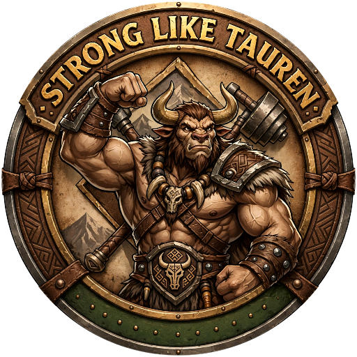

<p align="center">
  
</p>

# Strong Like Tauren

**A smart workout buddy for WoW Forever: it breaks up your sitting every 30 minutes, turns questing, dings and deaths into bonus sets, and never interrupts a fight.**

Targets World of Warcraft: Forever (client 1.60.1, interface `16001`). Inspired by FitCraft.

## What it does

- **Walkabouts every ~30 minutes.** Sit for half an hour and a short, 2-minute Walkabout comes due: a walk, some marching, calf raises or a stretch. Ignore it and nothing piles up; it only grows a little, to 5 minutes at most.
- **Rage-powered Feats of Strength.** Playing fills your Rage bar. Quests, level-ups, deaths and boss kills fill it faster (repeats are worth less). A full bar earns a Feat: two exercises, with a floor and a cap so you never get a flood or a drought.
- **Remembers your muscles.** Feats pick what you've rested longest, and no muscle group gets more than 1.5 sets in any hour or 6 in a day. No more 50 burpees because you died five times.
- **Never interrupts a fight.** Anything due in combat, a boss encounter, a raid or a dungeon waits quietly in your Totem and shows up at a safe moment.
- **Your workout, your rules.** Turn exercises on and off, add your own, filter for quiet / no floor / easy on wrists / the equipment you own, and share exercise lists with a short string.
- **Tiers from Critter to Tauren.** Scale every Feat from 25% (Critter) up to 200% (Tauren), or set per-exercise and per-muscle-group levels.
- **Progress that's fun.** History and stats, reputation with the Bloodhoof Athletic Club, a daily quest, streaks and achievements.
- **`/tauren`** opens everything. Not medical advice; stop if it hurts.

## How it works

Every 30 minutes you sit, a 2-minute **Walkabout** comes due. Ignoring it never builds debt; it just grows, to 5 minutes at most. Playing fills **Rage**: a full bar every 90 minutes, faster from quests, dings, deaths and bosses, with repeats worth less. A full bar earns a **Feat of Strength** (2 exercises), at most one per 45 minutes, delivered with your next Walkabout. Feats pick the muscles you've rested longest, and no muscle group gets more than 1.5 sets in any hour or 6 in a day. Anything due in combat or a dungeon waits in your **Totem** until you're free.

| Per hour of play | Leveling (20 quests + ding) | Level 60 (2 quests) | Level 60 (no events) |
|---|---|---|---|
| Rage gained | ~170 (quests 53 + ding 50 + passive 67) | ~83 | 67 |
| Walkabouts | 2 | 2 | 2 |
| Feats of Strength | 1.33 (capped by the 45-minute cooldown) | ~0.8 | 0.67 (floor) |
| Load on any one muscle group | at most 1.5 sets | at most 1.5 sets | at most 1.5 sets |

Principles: time drives the schedule and events add flavor; your body state is remembered account-wide; fights are never interrupted; **nothing is ever owed** (missed work merges or expires, and partial effort counts); one click to done / partial / snooze / swap / skip with no guilt; and the real exercise name is always visible, with the pun as a bonus.

## Features

- **Totem**: a movable corner tracker that stacks what's pending (pun plus real exercise name, amount, and Done / Partial / Snooze / Swap / Skip). It collapses to a header with the seated clock, Rage bar and reputation bar.
- **Walkabouts**: timed light movement on a seated clock. Standing up for real activity resets it. Overdue Walkabouts add a "Rooted" debuff that grows the break, up to 5 minutes, and never blocks play.
- **Feats of Strength**: two exercises on different muscle groups, flavored by what earned the Rage (a death earns a cardio "penance", a boss earns legs, and so on).
- **Rage sources**: passive play time, quests, level-ups, deaths, boss kills, first visit to a map, and Hearthstone use. Each is adjustable, and 0 disables it.
- **Tiers**: Critter 25%, Peon 50%, Grunt 100%, Kodo 150%, Tauren 200%, or a custom percentage.
- **Fatigue-aware picks**: rested muscles first, hard caps per hour and day, a "Why this?" tooltip, and Swap (up to 3 per slot) that keeps the same load.
- **Filters and equipment**: Quiet (no jumping), No floor, Easy on wrists, Equipment I have, and Rest day.
- **Share strings**: export and import exercise lists as a checksummed, sanitized string with a preview before anything is added.
- **Reputation**: climb from Hated to Exalted with the Bloodhoof Athletic Club.
- **Daily quest**: "Earthmother's Calling". Streaks count days you actually played, so days off never break one.
- **Achievements**: Kodo Thighs, Shield Wall, Exalted, seven-day streaks and more, with a toast.
- **Away detection**: if you walk off, the addon asks "Did you get up?" and credits long breaks.
- **History**: every outcome is logged, with undo, manual logging (`/tauren log 20 pushups`) and stats for today, 7 days and lifetime.

## Commands

`/tauren` (alias `/slt`)

| Command | What it does |
|---|---|
| `/tauren` | Toggle the main window |
| `/tauren now` | Take a Walkabout now |
| `/tauren up` | Tell the addon you got up (resets the seated clock) |
| `/tauren log <n> <exercise>` | Log exercise you did away from the Totem, e.g. `/tauren log 20 pushups` |
| `/tauren snooze <min>` | Snooze reminders |
| `/tauren pause [min]` | Pause reminders |
| `/tauren resume` | Resume reminders |
| `/tauren tier <critter\|peon\|grunt\|kodo\|tauren\|NN>` | Set your intensity tier or a custom percentage |
| `/tauren rest on\|off` | Rest day: Walkabouts continue, Rage pauses |
| `/tauren stats` | Print a stats summary |
| `/tauren selftest` | Run the built-in self tests |
| `/tauren sim <A-F\|all>` | Run a pacing simulation scenario |
| `/tauren debug` | Show diagnostic state |
| `/tauren bug` | Show the recent error log for bug reports |
| `/tauren resetui` | Reset window and Totem positions |
| `/tauren help` | List commands |

## Settings overview

Open with `/tauren` and choose Settings, or find the page under Esc, Options, AddOns. Options include: intensity tier and per-group levels; Walkabout interval, length and health-dose presets (Minimum, Recommended, Max benefit); Rage rates, cooldown and Feat size (1 to 3 exercises); per-hour and per-day muscle caps and the fatigue half-life; filters and equipment; dungeon behavior (hold until exit, or nudge between pulls); away detection; Totem lock, scale and position; sound and center-text toggles; minimap button; and accessibility options such as "Seated breaks count".

## The science

The defaults are built on published research. This is a game add-on that borrows ideas from it, not a clinical tool.

| Finding | Source | Design use |
|---|---|---|
| 5 minutes of light walking every 30 minutes cut post-meal glucose spikes by about 58% and lowered blood pressure by 4 to 5 mmHg versus sitting all day; 1 minute per hour helped blood pressure, not glucose | Duran, ..., Diaz (2023). *Medicine & Science in Sports & Exercise* | 30-minute Walkabouts; "Max benefit" is 5 minutes |
| 3 minutes of squats, calf raises and knee raises every 30 minutes during 4 hours of evening sitting: glucose down 31.5%, insulin down 26.6% | Gale et al. (2023). *Medicine & Science in Sports & Exercise* | Squats and calf raises as Walkabout moves |
| 2 minutes of light walking every 20 minutes improved glucose; standing breaks did not | Bailey & Locke (2015). *Journal of Science and Medicine in Sport* | "Walk, don't just stand" |
| Long uninterrupted sitting bouts were linked to higher mortality. The "under 30 minutes" figure comes from press coverage of the study, not the paper's own abstract | Diaz et al. (2017). *Annals of Internal Medicine* | 30-minute maximum seated stretch |
| 9.5 or more hours a day of sedentary time was associated with higher mortality | Ekelund et al. (2019). *BMJ* | Seated-play total on the Today tab |
| Limit sedentary time; any intensity helps; 150 to 300 minutes of moderate activity a week; strength work on 2 or more days | Bull et al. (2020). WHO guidelines. *British Journal of Sports Medicine* | Health page targets; daily quest |
| About 3 bouts a day of 1 to 2 minutes of vigorous activity were associated with 38 to 40% lower all-cause mortality (observational) | Stamatakis et al. (2022). *Nature Medicine* | Feats of Strength as "exercise snacks" |
| Blood clots in the legs reported after marathon gaming sessions | Case report (2013). *Journal of Medical Case Reports* | Calf raises in Walkabouts; longer overdue breaks |

Full references:

1. Duran AT, ..., Diaz KM (2023). Breaking up prolonged sitting to improve cardiometabolic risk: dose-response analysis of a randomized crossover trial. *Medicine & Science in Sports & Exercise*.
2. Gale JT et al. (2023). Breaking up evening sitting with resistance activity improves postprandial glycemic response. *Medicine & Science in Sports & Exercise*.
3. Bailey DP, Locke CD (2015). Breaking up prolonged sitting with light-intensity walking improves postprandial glycemia, but breaking up sitting with standing does not. *J Sci Med Sport*.
4. Diaz KM et al. (2017). Patterns of sedentary behavior and mortality in U.S. middle-aged and older adults. *Annals of Internal Medicine*.
5. Ekelund U et al. (2019). Dose-response associations between accelerometry measured physical activity and sedentary time and all cause mortality. *BMJ*.
6. Bull FC et al. (2020). World Health Organization 2020 guidelines on physical activity and sedentary behaviour. *Br J Sports Med*.
7. Stamatakis E et al. (2022). Association of wearable device-measured vigorous intermittent lifestyle physical activity with mortality. *Nature Medicine*.
8. Case report (2013). Extensive deep vein thrombosis following prolonged gaming ("gamer's thrombosis"). *Journal of Medical Case Reports*.

## Disclaimer

Strong Like Tauren is a game add-on, not medical advice. Check with a doctor if you have health conditions, start easy, and stop anything that hurts. Skipping is always fine.

## Known limitations

- **A game crash loses that session's saved data.** WoW writes SavedVariables on logout and `/reload`, so a crash means the addon's progress for that session is not saved.
- **The addon can't see you off-screen.** It can only tell when you've stopped playing, so after a break it asks "Did you get up?" Long absences are credited, with a one-click "I was sitting" to undo.
- **Forever's Hardcore mode isn't specifically supported yet.**

## For developers

Layout (the repo root is the addon folder; load order is in `StrongLikeTauren.toc`):

```
Locales/   enUS strings
Core/      Util, Const (options schema), Actions, Commands, Init
Data/      Exercises, Achievements, Quips, Health
Logic/     pure Lua: Library, History, Fatigue, Rage, Seated, Picker, Queue, Progress, Codec, Scheduler
Store/     DB (init, migrations, character key)
Game/      Api (the only file that queries WoW), Events
UI/        Theme, Totem, Toast, Countdown, Prompts, MainWindow + tabs, Options, MinimapButton, FirstRun, Share
Test/      SelfTest, Sim
Media/     shipped textures
art/       artwork source (not shipped)
docs/      REQUIREMENTS.md, ARCHITECTURE.md, logo.png
tools/     run-tests.lua, smoke.lua, make-art.ps1
```

Architecture notes are in `docs/ARCHITECTURE.md`; product requirements are in `docs/REQUIREMENTS.md`.

Commands:

- `luajit tools/run-tests.lua` runs the pure-logic tests outside the game.
- `luajit tools/smoke.lua` runs the smoke test.
- `/tauren selftest` and `/tauren sim all` run the same checks and the pacing simulations in game.
- `powershell -File tools\make-art.ps1` rebuilds `Media/SLT_Logo.tga`, `Media/SLT_Icon.tga` and `docs/logo.png` from `art/logo-source.webp` (Windows built-in imaging only; use `-PreviewOnly` to check previews first).
- Link the repo into the game with a directory junction (run in PowerShell; adjust the game path):

  ```powershell
  New-Item -ItemType Junction `
    -Path "C:\Program Files (x86)\World of Warcraft\_forever_\Interface\AddOns\StrongLikeTauren" `
    -Target "<path to this repo>"
  ```
- `.\release.ps1` builds `dist\StrongLikeTauren-<version>.zip` containing only runtime files. CurseForge's packager uses `.pkgmeta`.

Credit: inspired by FitCraft. Strong Like Tauren is original code and shares nothing with it.

## License

The source code is released under the MIT License (see `LICENSE`). The "Strong Like Tauren" name, the logo and all artwork (`Media/`, `art/`, `docs/logo.png`) are **not** covered by MIT and remain all rights reserved. World of Warcraft is a trademark of Blizzard Entertainment; this addon is unaffiliated with and not endorsed by Blizzard.
